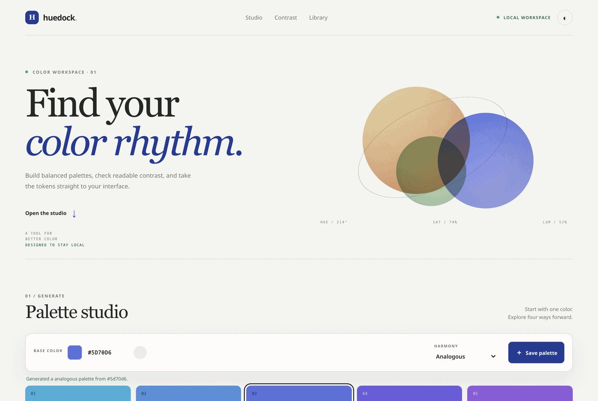

# HueDock

**HueDock** is a local-first color workspace for building palettes, checking text contrast against WCAG 2.x thresholds, and exporting CSS custom properties.



## Features

- Four five-color harmony sets: analogous, complementary, triadic, and tetradic.
- HEX and native color-picker inputs, plus a cryptographically randomized color button.
- Text/background contrast ratio with AA and AAA checks for normal and large text.
- Black/white text recommendation and a live contrast preview.
- Save palettes in browser storage; import and export a portable JSON backup.
- Copy swatches and CSS tokens, keyboard shortcut `Ctrl/⌘ + K`, and dark/light themes.
- No account, analytics, remote fonts, dependencies, or network calls. Saved palettes stay in this browser profile unless exported.

## Run locally

Serve this directory over localhost (ES modules may be blocked when opening `index.html` directly as a `file://` URL). For example, with Python installed:

```sh
python -m http.server 8000
```

Then visit `http://localhost:8000`. The app itself has no build step.

## Development

Requires Node.js 20 or newer for the built-in test runner:

```sh
npm run check
```

## Accessibility note

Contrast checks use the WCAG 2.x ratio thresholds: 4.5:1 for AA normal text, 3:1 for AA large text, 7:1 for AAA normal text, and 4.5:1 for AAA large text. This does not replace a complete accessibility review.

## License

MIT. See [LICENSE](LICENSE).
